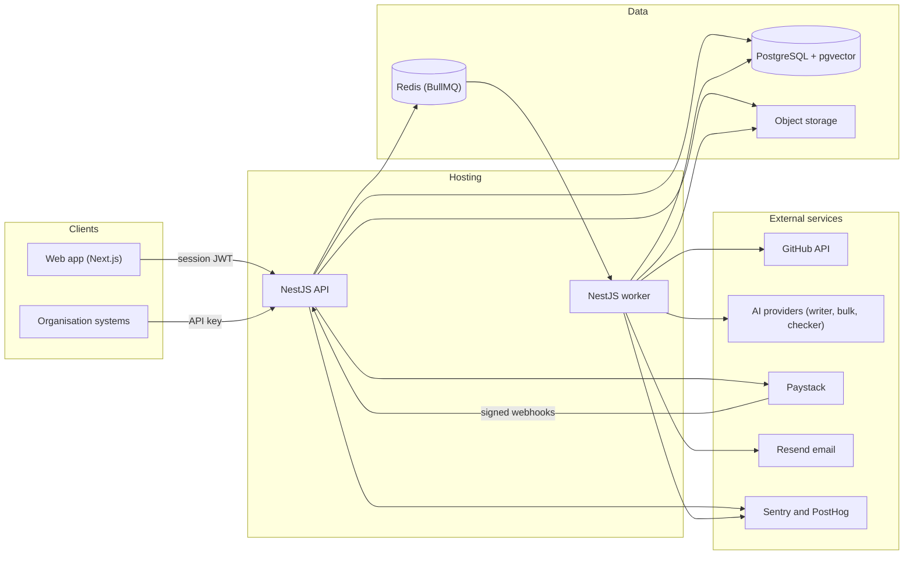
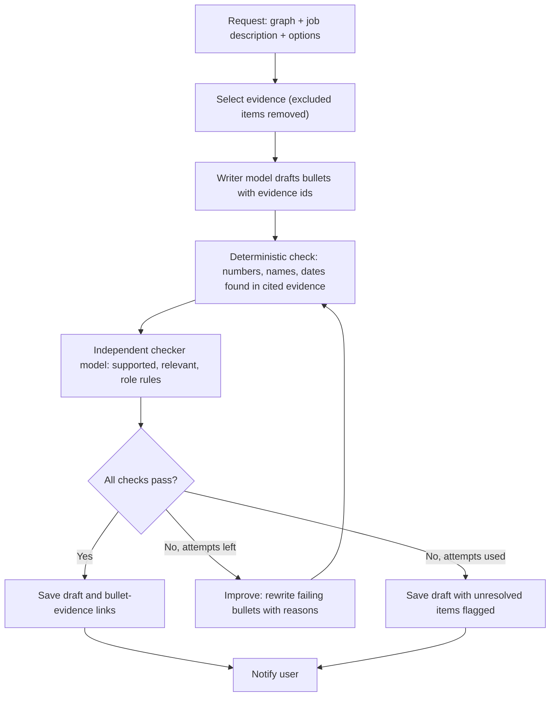
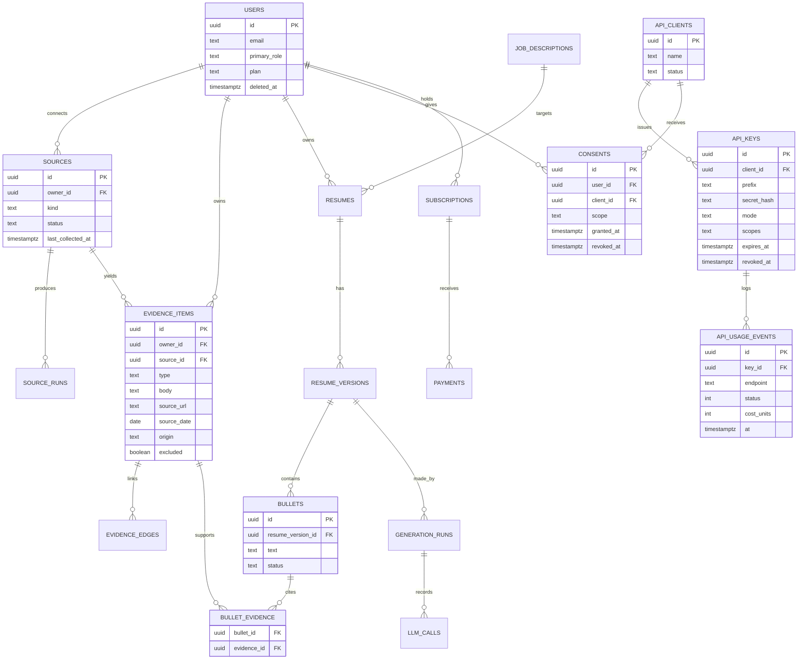
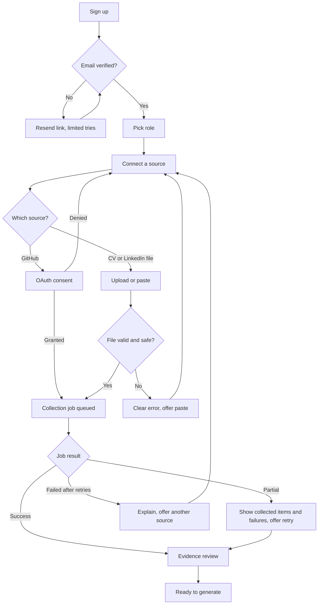
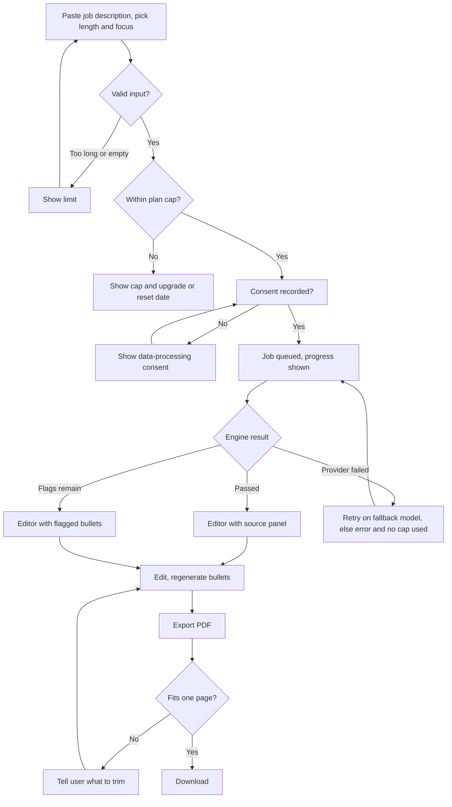
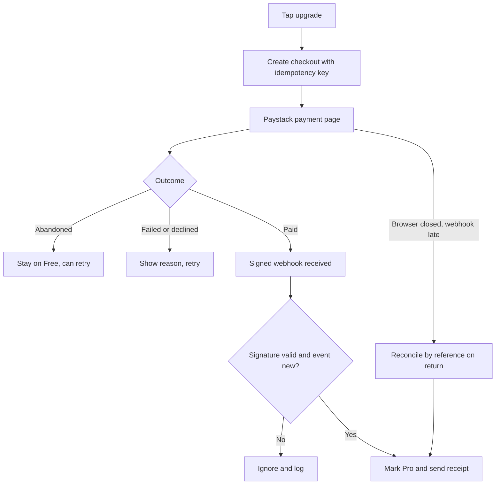
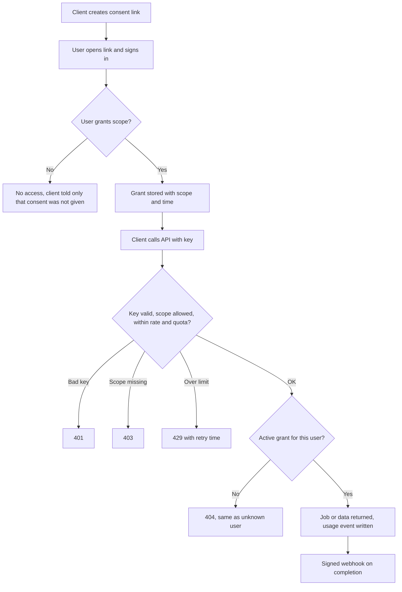
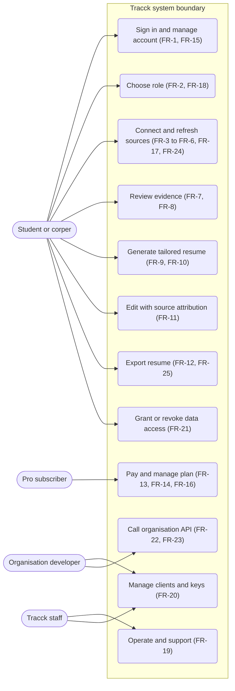

# Architecture

Status: Draft for review | Stack approved 2026-10-19 ([02-tech-stack.md](02-tech-stack.md)) | Priorities use M (must), S (should), C (could), W (won't, this release). Phase 1 means the first public release. No timelines appear in this PRD.

## Functional requirements

Each requirement links to the milestone tasks that build it in [04-requirements.md](04-requirements.md).

### FR-1
**Accounts and sign-in.** A person can register and sign in with email or Google, verify their email, reset a password, and sign out of all devices.
Priority: M. Acceptance: a new user reaches the dashboard after verifying email; a reset link works once and expires; "sign out everywhere" invalidates other sessions. Built by [M1-T3](04-requirements.md#m1-t3).

### FR-2
**Role selection and onboarding.** A user picks one primary role (Developer, Dev Rel or Community, Social Media Manager, Virtual Assistant, UI/UX Designer, Data Analyst) and is guided to connect at least one source.
Priority: M. Acceptance: role is stored and changeable; onboarding can be left and resumed; a user with no sources sees an empty state with the next step. Built by [M4-T4](04-requirements.md#m4-t4).

### FR-3
**GitHub connection and collection.** A user connects GitHub by OAuth, and Tracck collects their public profile, repositories, languages, commits authored by them, pull requests, issues and reviews in the background. Private repositories are not requested in Phase 1.
Priority: M. Acceptance: for a test account with 50 public repositories, collection finishes with status and counts shown; collection works with only public data and no `repo` scope ([A-46](05-assumptions-risks-questions.md#a-46)); the user can disconnect and delete collected GitHub data. Built by [M2-T2](04-requirements.md#m2-t2).

### FR-4
**CV upload.** A user uploads a PDF or DOCX CV (up to 5 MB) and Tracck extracts roles, education, skills and projects as evidence items.
Priority: M. Acceptance: 90% of CVs in the test set yield correct employer, role and dates; unreadable files give a clear error and a paste option. Built by [M2-T3](04-requirements.md#m2-t3).

### FR-5
**LinkedIn import without the API.** A user can import LinkedIn information by pasting text, uploading a LinkedIn "Save to PDF" profile, or uploading the data export ZIP. Tracck never asks for LinkedIn credentials and never scrapes ([A-49](05-assumptions-risks-questions.md#a-49)).
Priority: M for paste and PDF, S for the ZIP (its contents are unconfirmed first-hand, [A-50](05-assumptions-risks-questions.md#a-50)). Acceptance: each route produces evidence items marked with source "LinkedIn (user-provided)". Built by [M4-T1](04-requirements.md#m4-t1).

### FR-6
**Portfolio link.** A user adds public portfolio or project links; Tracck fetches the public page text and records it as evidence.
Priority: S. Acceptance: a link to a public page produces an evidence item with the URL and fetch date; private, redirecting-to-login and internal addresses are refused ([UP-14](#up-14)). Built by [M4-T2](04-requirements.md#m4-t2).

### FR-7
**Career Graph.** All evidence from all sources is stored as a persistent graph of evidence items, skills, projects, roles and claims, owned by the user and reusable across resumes.
Priority: M. Acceptance: every graph node records its source, source date, collection date and owner; duplicates across sources (the same project in GitHub and a CV) are merged or linked; the user can see the graph as a list by source. Built by [M2-T4](04-requirements.md#m2-t4).

### FR-8
**Light evidence review.** Before a first generation, the user sees the collected evidence grouped by source and can mark items as "use", "don't use" or edit the wording. Decided 2026-10-16.
Priority: M. Acceptance: excluded items never appear in a generated resume; edits are stored as user-authored evidence. Built by [M3-T5](04-requirements.md#m3-t5).

### FR-9
**Job-driven generation request.** A user pastes a job description (paste only, no URL fetching), chooses one page or full length, and optionally enters a focus ("backend", "leadership").
Priority: M. Acceptance: descriptions up to 15,000 characters are accepted; longer ones are rejected with a clear message; the three options reach the generation step. Built by [M3-T7](04-requirements.md#m3-t7).

### FR-10
**Write, check and improve engine.** Given the Career Graph and a job description, the system drafts resume content with a writer model, checks every bullet with an independent checker model from a different family, and revises until checks pass or an attempt limit is reached.
Priority: M. Acceptance: on the evaluation set, 0 invented numbers, names or dates; every bullet cites at least one evidence item or is shown as user-authored; attempt limit is 3, after which the draft is shown with unresolved items flagged ([UP-19](#up-19)). Built by [M3-T3](04-requirements.md#m3-t3).

### FR-11
**Editor with source attribution.** The user edits the draft in the browser. Each bullet shows the evidence it came from. The user can accept, rewrite, delete, or regenerate a bullet.
Priority: M. Acceptance: opening any bullet shows its sources with links; an edited bullet loses its "verified" marker if the user adds a claim with no evidence, and is labelled "user-authored"; changes save automatically and survive a refresh. Built by [M3-T6](04-requirements.md#m3-t6).

### FR-12
**PDF export.** The user exports the resume as a single-column PDF with real selectable text.
Priority: M. Acceptance: text order extracted by three PDF text extractors matches reading order on the test set ([NFR-15](#nfr-15)); a one-page resume fits on one page or the user is told what to trim; file is under 300 KB. Built by [M2-T6](04-requirements.md#m2-t6).

### FR-13
**Plans, entitlements and fair-use cap.** Free and Pro plans exist. Pro has a monthly generation cap (fair use), decided 2026-10-19; the cap value is set after cost per resume is measured ([Q-10](05-assumptions-risks-questions.md#q-10)). Users see their usage and the reset date.
Priority: M. Acceptance: when the cap is reached the user is told before starting, not after a failed run; a cap change takes effect without a deploy. Built by [M5-T1](04-requirements.md#m5-t1).

### FR-14
**Payments.** A user can subscribe to Pro with a Nigerian card or bank transfer through Paystack, see receipts, cancel, and recover from failed renewals.
Priority: M. Acceptance: successful payment unlocks Pro within 60 seconds of the webhook; duplicate and forged webhooks change nothing; a failed renewal gives a grace period and email notice. Built by [M5-T2](04-requirements.md#m5-t2) and [M5-T3](04-requirements.md#m5-t3).

### FR-15
**Privacy controls.** A user can see what is stored, export their data, disconnect any source, and delete their account. Consent for processing and for sending data to AI providers is asked and recorded.
Priority: M. Acceptance: deletion removes the user's rows, files and derived data and queues provider-side deletion where one exists; a consent record exists before the first generation. Built by [M6-T1](04-requirements.md#m6-t1) and [M6-T2](04-requirements.md#m6-t2).

### FR-16
**Transactional email.** Verification, reset, receipt, renewal-failure and deletion-confirmation emails are sent from an authenticated domain.
Priority: M. Acceptance: SPF, DKIM and DMARC pass for the sender domain; a bounced address marks the account's email as unreachable. Built by [M5-T4](04-requirements.md#m5-t4).

### FR-17
**Source status and refresh.** The user sees each source's state (connected, collecting, partial, failed, disconnected) and can refresh it manually.
Priority: S. Acceptance: partial failures show what was collected and what failed, with a retry. Built by [M4-T5](04-requirements.md#m4-t5).

### FR-18
**Remaining role profiles.** Role-specific writing and scoring rules exist for all six roles.
Priority: S (Developer is M and ships first). Acceptance: each role has a rubric, example outputs reviewed by a practitioner, and evaluation cases. Built by [M4-T3](04-requirements.md#m4-t3).

### FR-19
**Admin and support tools.** Staff can look up a job, see its failure reason, re-run or cancel it, suspend an account or API key, and every action is logged.
Priority: S. Acceptance: no staff action is possible without an audit log entry; staff cannot read resume text without an explicit, logged "view as support" step. Built by [M6-T5](04-requirements.md#m6-t5).

### FR-20
**Organisation clients and per-client API keys.** Staff create an organisation client; the client creates multiple labelled keys (live and sandbox) with scopes, expiry, rotation, revocation, per-key rate limits and quotas. Secrets are shown once and stored hashed.
Priority: S (Phase 3). Acceptance: a revoked key fails within 60 seconds; usage is attributable to a key; one client can never read another client's data ([NFR-7](#nfr-7)). Built by [M9-T1](04-requirements.md#m9-t1) and [M9-T2](04-requirements.md#m9-t2).

### FR-21
**User consent for organisation access.** An organisation can receive a user's data only after that user grants a named client a named scope, and the user can see and revoke grants.
Priority: S (Phase 3). Acceptance: calls without an active grant return an error that does not reveal whether the user exists; revocation takes effect immediately. Built by [M9-T3](04-requirements.md#m9-t3).

### FR-22
**Organisation data endpoints.** Authorised clients can request a resume generation for a consenting user and fetch the result, and can receive webhooks for completion.
Priority: S (Phase 3). Acceptance: generation through the API uses the same engine and the same checks as the web app; results are delivered by webhook signed with a per-client secret. Built by [M9-T4](04-requirements.md#m9-t4).

### FR-23
**Usage metering and audit for organisations.** Each API call is recorded with client, key, endpoint, status, cost units and time; clients see their own usage.
Priority: S (Phase 3). Acceptance: usage totals match raw events within 0.1%. Built by [M9-T5](04-requirements.md#m9-t5).

### FR-24
**Phase 2 sources.** X (through the user's data archive), Figma (OAuth and link), and Behance (links, PDF, manual entry).
Priority: C. Acceptance: each adds evidence items with correct source labels; X archive parsing reads only the posts file and discards everything else on upload. Built by [M8-T1](04-requirements.md#m8-t1), [M8-T2](04-requirements.md#m8-t2) and [M8-T3](04-requirements.md#m8-t3).

### FR-25
**Phase 2 features.** DOCX export, match report with gap suggestions, full evidence library, saved resumes per job.
Priority: C. Acceptance: defined per feature when promoted from Could. Built by [M8-T4](04-requirements.md#m8-t4) to [M8-T7](04-requirements.md#m8-t7).

### FR-26
**Won't do in this release.** Cover letters, interview preparation, job search, automatic applications ([NG-5](01-overview.md#goals-non-goals-success-metrics)); scraping or third-party scraping providers ([NG-4](01-overview.md#goals-non-goals-success-metrics)); fetching a job description from a URL; an export score threshold.
Priority: W.

## Non-functional requirements

### NFR-1
Performance. Median time from generation request to finished draft is 90 seconds or less and the 95th percentile is 180 seconds or less, excluding first-time source collection. Verified by timing every job in the queue and checking on the evaluation set under normal load.

### NFR-2
Performance. First-time GitHub collection for an account with up to 50 public repositories completes within 5 minutes at the 95th percentile, and progress is visible and survives leaving the page. Verified with test accounts of 5, 50 and 200 repositories.

### NFR-3
Availability. The web app and internal API are available 99.5% of each month, excluding announced maintenance. Verified by an external uptime monitor. No availability promise is made to organisations until the first client contract defines one.

### NFR-4
Performance for organisations. Read endpoints respond within 500 ms at the 95th percentile at the API edge. Generation endpoints return a job identifier within 500 ms and finish asynchronously. Verified by load tests and the usage events.

### NFR-5
Reliability. No queued job is lost across a worker or Redis restart. Failed jobs retry at most 3 times with exponential backoff, then move to a dead-letter queue and show a failed state to the user. Side effects (emails, charges, state changes) are idempotent. Verified by killing the worker and Redis mid-run in tests ([A-20](05-assumptions-risks-questions.md#a-20)).

### NFR-6
Output quality. On the evaluation set: 0 invented numbers, organisations, dates or job titles; 100% of bullets cite evidence or are labelled user-authored; blind reviewers rate Tracck resumes at least equal to a human-written baseline ([G-2](01-overview.md#goals-non-goals-success-metrics)). Verified by the evaluation harness on every model or prompt change.

### NFR-7
Tenant isolation and access control. A user can read only their own data, and an organisation key only data for users who granted that client access. Verified by automated tests that try cross-user and cross-client reads on every endpoint, plus database row-level policies as a second layer. Zero failures allowed.

### NFR-8
Privacy and deletion. Account deletion completes within 30 days (proposed, [Q-9](05-assumptions-risks-questions.md#q-9)), the user is emailed on completion, and personal data does not appear in logs or error reports. Verified by a deletion test that checks every table and storage path, and a log scan.

### NFR-9
Cost control. Cost per generated resume stays under a figure set after measurement ([Q-10](05-assumptions-risks-questions.md#q-10)). A daily spend limit per provider stops new generations and alerts staff at 80% of the limit. Every model call records tokens and cost. Verified by a test that exceeds the limit.

### NFR-10
Low bandwidth. The app shell loads in 4 seconds or less on a throttled "Slow 4G" profile on a mid-range Android phone, with an initial script payload of 200 KB or less compressed. The editor autosaves and recovers after a dropped connection. Verified by Lighthouse and manual tests on a real low-end device.

### NFR-11
Accessibility. Core flows (sign-up, onboarding, generate, edit, export) meet WCAG 2.2 AA. Verified by automated checks and a manual keyboard and screen-reader pass.

### NFR-12
Browser support. The latest two versions of Chrome, Safari, Firefox, Edge and Samsung Internet, with Android Chrome as the priority. Verified by an end-to-end suite on Chromium and a manual pass on the others.

### NFR-13
Backup and recovery. Recovery point 24 hours or less, recovery time 4 hours or less. Backups are restored in a drill before the private beta. Verified by the drill. Backup features of the database plan are unconfirmed ([A-57](05-assumptions-risks-questions.md#a-57)).

### NFR-14
Observability. Every request, job and model call carries a trace identifier. An alert reaches the developer within 5 minutes when the job failure rate passes 5% over 15 minutes or the queue is stuck. Verified by inducing each failure in staging.

### NFR-15
ATS compatibility. Exported PDFs are single column, use standard headings and embedded fonts, and extract in reading order with three different text extractors. Compatibility with real applicant tracking systems used by Nigerian employers is unverified ([A-3](05-assumptions-risks-questions.md#a-3)), so the product does not claim "ATS-proof".

### NFR-16
Provider independence. Changing the writer, checker or bulk model is a configuration change plus an evaluation run, with no change to feature code. Verified by swapping providers in a test.

### NFR-17
Scalability. The system handles 10 times the launch scale (20,000 registered users) by changing instance sizes and plan limits, not code. Verified by a load test with 100 concurrent generations and a queue-depth check.

### NFR-18
Abuse limits. Per-user and per-IP rate limits apply on sign-up, sign-in, uploads, generations and API calls, with limits set in configuration. Verified by tests that exceed each limit.

## High-level architecture

**Components and boundaries**
- **Web app.** Renders pages, calls the API with the user's session. Holds no secrets and calls no AI or source provider directly.
- **API process.** Authenticates users (session) and organisations (API keys), enforces permissions, plans and quotas, accepts uploads, creates jobs, serves results, receives payment webhooks.
- **Worker process.** Runs queued jobs: source collection, file parsing, evidence extraction, generation, PDF rendering, email, deletion, retention. The only process that calls source and AI providers.
- **PostgreSQL.** System of record, including the Career Graph and billing state. Every user-owned table carries an owner identifier, and every organisation-related table a client identifier, from the first migration.
- **Redis.** Queue state only. It holds no data that cannot be rebuilt from Postgres ([DR-4](02-tech-stack.md#dr-4-redis-run-by-the-team-not-a-hosted-queue-service)).
- **Object storage.** Uploaded CVs and archives, and exported PDFs.
- **AI gateway.** A module inside the worker that sends validated, schema-checked requests to the configured model for each role ([DR-6](02-tech-stack.md#dr-6-ai-models-and-routing), [DR-7](02-tech-stack.md#dr-7-structured-output-and-validation)).

**Generation pipeline (inside the worker)**

## Data model sketch

Retention values are proposals, to be confirmed in [Q-9](05-assumptions-risks-questions.md#q-9).

Other tables not drawn: `role_profiles`, `source_runs`, `evidence_edges`, `job_descriptions`, `generation_runs`, `llm_calls` (model, tokens, cost, latency, no prompt text by default), `subscriptions`, `payments`, `webhook_events` (provider event id, unique), `usage_counters`, `deletion_requests`, `audit_log` (append only).

**Ownership.** `owner_id` on every user-owned row. Database row-level policies restrict reads to the owner for browser-facing access, and the API adds its own checks ([NFR-7](#nfr-7)).

| Data | Contains personal data | Proposed retention |
|---|---|---|
| Uploaded CV, archive and export files | Yes | Deleted after extraction succeeds, or after 30 days if extraction fails, unless the user keeps them |
| Evidence items | Yes | Until the user deletes the source or the account |
| Resumes, versions, bullets | Yes | Until deleted by the user, plus up to 30 days in backups |
| LLM call records | Metadata only, no prompt text | 90 days |
| Payment records | Yes (reference, amount, time, no card data) | As the law requires, to be confirmed by counsel |
| Audit log | Staff and API actions | 12 months |
| Webhook events | Provider ids | 90 days |

## API and integration contracts

**Conventions.** REST over HTTPS under `/v1`, JSON bodies. Errors use the `application/problem+json` shape with a stable `code`. Every state-changing POST accepts an `Idempotency-Key` header; repeating a key with the same body returns the first result, and with a different body returns a conflict. Lists use cursor pagination. Long work returns `202 Accepted` with a job resource to poll or a webhook. Rate-limit headers are returned on every response.

**Authentication models**
- Web users: session token issued by the auth service, sent as a bearer token, validated on every request.
- Organisations: `Authorization: Bearer trk_<mode>_<prefix>_<secret>`. Only a hash of the secret is stored. Keys are shown once at creation. Each key has scopes, mode (live or sandbox), expiry, per-key rate limit and quota ([FR-20](#fr-20)).
- Payment webhooks: verified by signature from the provider before any state change.
- Organisation webhooks: signed with a per-client secret and a timestamp, so receivers can reject replays.

**Main endpoints (web app)**

| Endpoint | Purpose |
|---|---|
| `POST /v1/sources/github/connect` and `GET /v1/sources` | Start OAuth, list sources and states |
| `POST /v1/uploads` | Upload a CV, LinkedIn PDF, or archive; returns a job |
| `POST /v1/sources/linkedin/paste` | Submit pasted LinkedIn text |
| `GET /v1/evidence` and `PATCH /v1/evidence/{id}` | Review, exclude or edit evidence |
| `POST /v1/resumes` | Create a resume from a job description with options; returns `202` and a job |
| `GET /v1/resumes/{id}` and `PATCH /v1/bullets/{id}` | Read and edit a draft |
| `POST /v1/resumes/{id}/export` | Render the PDF; returns a signed, expiring download link |
| `GET /v1/me/usage` | Plan, usage and cap |
| `POST /v1/billing/checkout` and `POST /v1/webhooks/paystack` | Start a payment and receive provider events |
| `POST /v1/me/export` and `DELETE /v1/me` | Data export and deletion request |

**Main endpoints (organisation API, Phase 3)**

| Endpoint | Purpose |
|---|---|
| `POST /v1/org/consent-links` | Create a link where a user grants this client a scope |
| `GET /v1/org/users/{id}/profile` | Read the career summary the user granted |
| `POST /v1/org/users/{id}/resumes` | Request generation for a consenting user; returns `202` |
| `GET /v1/org/jobs/{id}` | Poll a job |
| `GET /v1/org/usage` | The client's own usage |
| Webhook `resume.completed` | Delivered to the client's registered address, signed |

**Provider interfaces.** The AI gateway exposes one internal call per role (`write`, `check`, `extract`) with a zod schema for each result, a timeout, a retry policy, and a cost record. Source adapters share one interface (`collect(user, source) -> evidence items, status`) so a new source is a new adapter and not a new pipeline.

**Provider-facing limits.** GitHub: respect the 5,000 per hour user limit and back off on secondary limits ([A-43](05-assumptions-risks-questions.md#a-43)). The Events API is not used for history because it covers only 30 days ([A-44](05-assumptions-risks-questions.md#a-44)); the commits and GraphQL contribution queries are used and queried in yearly windows ([A-45](05-assumptions-risks-questions.md#a-45)).

## User flows

### Flow A: first-time onboarding and source collection

### Flow B: generate and export a resume

### Flow C: upgrade to Pro

### Flow D: organisation request (Phase 3)

## Use case diagram

FR-26 lists what is out of scope, so it has no use case.

## Unhappy paths

Each path comes from the checklist in the writing guide, filtered to what can happen in this product. "Covered by" links to the task that builds the behaviour.

### UP-1
**Malformed, huge or unexpected CV, or wrong file type.** Impact: failed collection, wasted queue time. Intended behavior: reject over 5 MB and wrong types at upload by content, not extension; corrupt files return a clear message with a paste option. Covered by [M2-T3](04-requirements.md#m2-t3).

### UP-2
**Malicious file (malware, zip bomb, script in a document).** Impact: worker compromise or crash. Intended behavior: files are scanned, parsed in a sandboxed worker with size, time and memory limits; ZIP entries are capped in count, size and path (no path traversal); the X archive upload is read for the posts file only. Covered by [M2-T3](04-requirements.md#m2-t3) and [M7-T2](04-requirements.md#m7-t2).

### UP-3
**Non-English text, emoji, unusual encodings, right-to-left names.** Impact: garbled output or parser errors. Intended behavior: all text is UTF-8, names are never altered, PDF fonts cover Latin with diacritics, and unsupported scripts produce a visible warning rather than blank boxes. Covered by [M2-T6](04-requirements.md#m2-t6).

### UP-4
**Email not received, typo in email, changed email.** Impact: user locked out at sign-up. Intended behavior: resend with a limit, a change-email flow that verifies the new address, and a visible "wrong email" option before verification. Covered by [M1-T3](04-requirements.md#m1-t3) and [M5-T4](04-requirements.md#m5-t4).

### UP-5
**Google sign-in down or account unlinked; same person with two accounts.** Impact: user cannot sign in or splits their evidence. Intended behavior: email sign-in always available; accounts with the same verified email are linked; a merge request goes through support. Covered by [M1-T3](04-requirements.md#m1-t3).

### UP-6
**GitHub token revoked, expired or access denied mid-collection; GitHub rate limit or outage.** Impact: partial or no data. Intended behavior: job pauses on a rate limit until reset and resumes; a revoked token marks the source "needs reconnect" and keeps existing evidence; partial results are shown ([FR-17](#fr-17)). Covered by [M2-T2](04-requirements.md#m2-t2) and [M4-T5](04-requirements.md#m4-t5).

### UP-7
**GitHub history limits.** Impact: old work missing, user thinks Tracck is wrong. Intended behavior: collect by yearly windows beyond the default one-year contribution window and 30-day Events API limit; show the date range collected ([A-44](05-assumptions-risks-questions.md#a-44), [A-45](05-assumptions-risks-questions.md#a-45)). Covered by [M2-T2](04-requirements.md#m2-t2).

### UP-8
**User has almost no public work (empty states).** Impact: weak or empty resume, disappointment. Intended behavior: tell the user what is missing and offer to add a CV or manual entries; never fill gaps with invented content ([NG-6](01-overview.md#goals-non-goals-success-metrics)). Covered by [M2-T5](04-requirements.md#m2-t5) and [M3-T3](04-requirements.md#m3-t3).

### UP-9
**User with huge history (power user).** Impact: long jobs, too much evidence for the model's context. Intended behavior: rank and trim evidence by relevance to the job and to the recent period, cap input size, and tell the user how many items were used. Covered by [M3-T3](04-requirements.md#m3-t3).

### UP-10
**Duplicate evidence across sources (same project in GitHub and the CV).** Impact: repeated bullets or conflicting dates. Intended behavior: link duplicates and prefer the user-provided description, flag conflicts for review. Covered by [M2-T4](04-requirements.md#m2-t4).

### UP-11
**Model hallucination, wrong output, refusal, malformed or truncated structured output.** Impact: false claims on a resume. Intended behavior: schema validation; deterministic check that each number, name and date appears in cited evidence; independent checker; unresolved items flagged; refusals and truncation retried then surfaced. Covered by [M3-T1](04-requirements.md#m3-t1) and [M3-T3](04-requirements.md#m3-t3).

### UP-12
**Prompt injection from uploaded files, GitHub README text, portfolio pages or job descriptions.** Impact: model follows instructions inside data, leaks other content, or alters output. Intended behavior: all external text is passed as data in delimited, labelled fields; the model has no tools and no access to other users' data; output must match the schema; injected instructions fail the evidence check; injection cases are in the evaluation set. Covered by [M3-T4](04-requirements.md#m3-t4).

### UP-13
**AI provider outage, latency spike, quota exhausted, model deprecated or changed.** Impact: failed or slow generation, changed quality. Intended behavior: retry then fall back to the configured secondary model of the same role; fallback is logged; cap is not consumed on failure; model changes require an evaluation run ([NFR-16](#nfr-16)). Covered by [M3-T1](04-requirements.md#m3-t1) and [M3-T2](04-requirements.md#m3-t2).

### UP-14
**Server-side request forgery through portfolio links.** Impact: access to internal services. Intended behavior: only public http and https addresses; block private, loopback and metadata addresses after DNS resolution and on every redirect; response size and time limits. Covered by [M4-T2](04-requirements.md#m4-t2).

### UP-15
**Cost runaway from a loop, abuse, or price change.** Impact: unbounded AI spend. Intended behavior: attempt limit of 3 in the loop; per-user cap and rate limits; daily provider spend limit with alert; price table reviewed when introductory prices end (1 December 2026, 1 January 2027, [A-33](05-assumptions-risks-questions.md#a-33)). Covered by [M3-T1](04-requirements.md#m3-t1) and [M5-T1](04-requirements.md#m5-t1).

### UP-16
**Payment pending for hours, succeeds but callback never arrives, user closes the browser.** Impact: user paid and has no Pro. Intended behavior: reconcile by payment reference on return and by a scheduled job against provider records. Covered by [M5-T2](04-requirements.md#m5-t2) and [M5-T5](04-requirements.md#m5-t5).

### UP-17
**Duplicate, out-of-order and forged payment webhooks; double-click and double payment.** Impact: double activation or free access. Intended behavior: verify signature; store provider event id uniquely; apply by state rules, not arrival order; idempotency key on checkout. Covered by [M5-T2](04-requirements.md#m5-t2).

### UP-18
**Renewal fails, card expires, user cancels, price changes mid-checkout.** Impact: surprise loss of access or charges. Intended behavior: grace period with email notice; expiring-card reminders; cancellation keeps access until period end; price is fixed at checkout. Retry behaviour of the provider is unconfirmed, so the app tracks state itself ([A-28](05-assumptions-risks-questions.md#a-28)). Covered by [M5-T3](04-requirements.md#m5-t3).

### UP-19
**Checker keeps failing a bullet after 3 attempts.** Impact: user receives unverified text. Intended behavior: the bullet is removed or shown flagged with the reason, never silently passed. Covered by [M3-T3](04-requirements.md#m3-t3).

### UP-20
**Background job runs twice, never runs, runs out of order, or is stuck; poison job.** Impact: duplicate evidence, duplicate emails, a user waiting forever. Intended behavior: job keys make runs idempotent; stuck jobs time out; after 3 retries a job goes to the dead-letter queue and the user sees a failed state with a retry. Covered by [M2-T1](04-requirements.md#m2-t1).

### UP-21
**Redis restarts, evicts keys or loses data.** Impact: queued jobs vanish. Intended behavior: persistence on, `noeviction`, and a recovery job that re-queues unfinished work from the database state ([A-20](05-assumptions-risks-questions.md#a-20)). Covered by [M2-T1](04-requirements.md#m2-t1) and [M7-T3](04-requirements.md#m7-t3).

### UP-22
**Two tabs or two devices editing the same resume.** Impact: lost edits. Intended behavior: each bullet has a version number; a stale save is rejected and the user sees the newer text with a choice. Covered by [M3-T6](04-requirements.md#m3-t6).

### UP-23
**Flaky or slow connection, tab closed mid-run, low-end phone.** Impact: lost work, frustration. Intended behavior: generation continues on the server; the user can return and find the result; editor autosaves and queues edits locally until reconnected ([NFR-10](#nfr-10)). Covered by [M3-T6](04-requirements.md#m3-t6) and [M7-T1](04-requirements.md#m7-t1).

### UP-24
**Bad deploy or migration that cannot be rolled back.** Impact: outage or data loss. Intended behavior: migrations are additive in two steps (expand, then contract); one-command rollback of the app; staging runs every migration first. Covered by [M1-T5](04-requirements.md#m1-t5).

### UP-25
**Database or Redis outage, full disk, backups never tested.** Impact: downtime or permanent loss. Intended behavior: alerts on disk and connection use; restore drill before beta ([NFR-13](#nfr-13)). Covered by [M7-T3](04-requirements.md#m7-t3).

### UP-26
**Secrets leaked or rotated; expired domain or certificate.** Impact: account takeover or outage. Intended behavior: secrets only in the platform's secret store; rotation runbook; domain and certificate expiry alerts. Covered by [M1-T1](04-requirements.md#m1-t1) and [M7-T4](04-requirements.md#m7-t4).

### UP-27
**Fake sign-ups, credential stuffing, scraping Tracck, brute-force on API keys.** Impact: cost and account compromise. Intended behavior: rate limits and email verification; lockout after repeated failures; key prefix lookups with constant-time hash comparison; failed-key attempts are rate-limited per IP. Covered by [M1-T3](04-requirements.md#m1-t3) and [M9-T2](04-requirements.md#m9-t2).

### UP-28
**User A reads user B's data, or one organisation reads another's; ID enumeration.** Impact: privacy breach. Intended behavior: owner checks on every query, row-level policies, unguessable identifiers, and identical responses for missing and forbidden records. Covered by [M1-T2](04-requirements.md#m1-t2) and [M9-T3](04-requirements.md#m9-t3).

### UP-29
**Staff mistake or abuse: deleting the wrong account, viewing private data.** Impact: privacy breach or data loss. Intended behavior: destructive actions need confirmation and a soft-delete window; reading resume text needs a logged reason ([FR-19](#fr-19)). Covered by [M6-T5](04-requirements.md#m6-t5).

### UP-30
**Deletion request while jobs run, in backups, or at providers.** Impact: data resurrected or retained. Intended behavior: deletion cancels the user's jobs, removes rows and files, schedules provider-side deletion where it exists, and ages out of backups within the retention window; the user is told what is outside Tracck's control. Covered by [M6-T2](04-requirements.md#m6-t2) and [M6-T3](04-requirements.md#m6-t3).

### UP-31
**A source changes its terms, API or response shape; vendor shuts down.** Impact: collection breaks or becomes non-compliant. Intended behavior: adapter tests detect shape changes; each source can be switched off by a flag without a deploy; each adapter has a documented fallback (file, paste or manual) ([A-49](05-assumptions-risks-questions.md#a-49), [A-52](05-assumptions-risks-questions.md#a-52)). Covered by [M2-T2](04-requirements.md#m2-t2) and [M8-T1](04-requirements.md#m8-t1).

### UP-32
**Resume shown as "ATS-proof" but rejected by an employer's system.** Impact: user trust and brand damage. Intended behavior: product copy promises readable, standard formatting only; extraction is tested with three tools ([NFR-15](#nfr-15)). Covered by [M2-T6](04-requirements.md#m2-t6) and [M7-T5](04-requirements.md#m7-t5).

### UP-33
**Resume or evidence content that is biased or inappropriate (for example, wording about gender, tribe, religion or age added by the model).** Impact: unfair or harmful output. Intended behavior: the writer is told never to infer or add protected attributes; the checker flags them; a feedback button on every draft records problems. Covered by [M3-T3](04-requirements.md#m3-t3) and [M7-T6](04-requirements.md#m7-t6).

### UP-34
**Organisation key misuse: leaked key, over-quota use, calls for users who did not consent, webhook receiver down.** Impact: data exposure or lost results. Intended behavior: revocation within 60 seconds; per-key quotas; consent check on every call; webhooks retry with backoff and results stay fetchable by polling. Covered by [M9-T2](04-requirements.md#m9-t2), [M9-T3](04-requirements.md#m9-t3) and [M9-T4](04-requirements.md#m9-t4).

### UP-35
**Timezone and currency handling for billing and caps.** Impact: caps reset at the wrong time, wrong amounts. Intended behavior: store times in UTC; caps reset on the user's billing date; money stored in kobo as integers; the display uses naira only. Covered by [M5-T1](04-requirements.md#m5-t1).

### UP-36
**A user finds the evidence collected about them is wrong or does not want a source used.** Impact: loss of trust. Intended behavior: every item can be excluded, edited or deleted from the review screen ([FR-8](#fr-8)). Covered by [M3-T5](04-requirements.md#m3-t5).

## Security, privacy, and compliance

**Sensitive data inventory:** email and name; education and employment history; links to public profiles; text from CVs and LinkedIn files; GitHub activity; job descriptions pasted by users; payment references (no card numbers); API key hashes; consent and audit records.

**Threat model summary**

| Threat | Control |
|---|---|
| Cross-user or cross-client reads | Owner and client checks on every query, row-level policies, tests ([NFR-7](#nfr-7)) |
| Stolen API key | Hash-only storage, visible prefix, scopes, expiry, rotation, per-key limits, revocation within 60 seconds |
| Malicious uploads | Content-type checks, size caps, sandboxed parsing, ZIP limits ([UP-2](#up-2)) |
| Prompt injection | Data delimiting, no tools for models, schema-checked output, evidence check ([UP-12](#up-12)) |
| SSRF through portfolio links | Address filtering after DNS and on redirects ([UP-14](#up-14)) |
| Webhook forgery and replay | Signatures, timestamps, unique event ids ([UP-17](#up-17)) |
| Session theft | Short-lived tokens, "sign out everywhere", secure cookies |
| Leaked secrets | Secret store, rotation runbook, no secrets in logs or the repository |
| Dependency vulnerabilities | Automated dependency alerts and a pinned lockfile |
| Staff overreach | Logged "view as support", append-only audit log |

**Privacy and compliance**
- Governing law: the Nigeria Data Protection Act 2023 and the GAID 2025 ([A-11](05-assumptions-risks-questions.md#a-11)). Whether Tracck must register as a controller of major importance, appoint a DPO, and file annual audit returns depends on user counts ([A-12](05-assumptions-risks-questions.md#a-12)); a data protection impact assessment is expected before launch ([A-13](05-assumptions-risks-questions.md#a-13)). Counsel confirms ([Q-6](05-assumptions-risks-questions.md#q-6)).
- Cross-border transfer: the database, the hosting region and the AI providers are outside Nigeria, so transfers need a lawful basis and documented safeguards ([A-14](05-assumptions-risks-questions.md#a-14)). There is no blanket localisation rule in the Act, but a Central Bank directive on payment data and a cloud classification framework are unclear for Tracck ([A-38](05-assumptions-risks-questions.md#a-38)).
- Consent is recorded per purpose (processing, sending to AI providers, sharing with a named organisation) with text version and time.
- AI providers: use paid API tiers whose terms state that data is not used to train models, and record that in the data processing terms (Gemini paid tier states this, [A-33](05-assumptions-risks-questions.md#a-33); OpenAI's terms were not read, [Q-11](05-assumptions-risks-questions.md#q-11)).
- Source terms: GitHub's terms bar selling personal information to recruiters, headhunters or job boards ([A-48](05-assumptions-risks-questions.md#a-48)). Organisation access therefore covers only data the user chose to share, and counsel reviews the B2B model before Phase 3. X data is read only from the user's own archive and its content rules are applied ([A-52](05-assumptions-risks-questions.md#a-52)). LinkedIn is never scraped, and scraping providers are excluded ([A-51](05-assumptions-risks-questions.md#a-51)).
- Logs contain identifiers, not resume text or email addresses.

## Observability and operations

- **Logging.** Structured logs (pino) with a trace identifier across API, job and model call; no personal text.
- **Metrics.** Queue depth and age, job duration and failure by type, model latency and cost by role, cap hits, checker failure rate, webhook failures, API errors by key.
- **Alerts.** Error rate, stuck queue, provider spend at 80% of the daily limit, webhook failures, disk and memory, certificate and domain expiry. All reach the developer within 5 minutes ([NFR-14](#nfr-14)).
- **Product analytics.** PostHog events for the metrics in [01-overview.md](01-overview.md#goals-non-goals-success-metrics): source collected, draft generated, export, upgrade. No resume text in events.
- **Deployment.** Container images built in CI, deployed to staging then production, with migrations run first as expand-only steps; one-command rollback of the application.
- **Backups.** Database backups and storage backups with a restore drill ([NFR-13](#nfr-13)). Redis can be rebuilt from Postgres state.
- **Runbooks.** Stuck queue, provider outage, leaked key, payment mismatch, deletion request, bad deploy.
- **Single-operator reality.** One person receives alerts, so alerts are few and actionable, and every runbook is short enough to follow tired.

## Testing strategy

- **Unit tests.** Parsers, evidence merging, plan and cap rules, idempotency, key hashing and scope checks.
- **Integration tests.** Source adapters against recorded GitHub responses, API with a real Postgres and Redis in Docker, queue retry and dead-letter behaviour.
- **End-to-end tests.** Sign-up, connect, collect, review, generate, edit, export on Chromium; sign-up through payment in the provider's test mode.
- **AI evaluation.** A test set of real and synthetic profiles and job descriptions covering each role, thin profiles, large profiles and injection attempts. Metrics: invented-claim count, bullets with evidence, reviewer score, cost and latency per resume. Runs on every prompt or model change ([NFR-6](#nfr-6)). Token estimates in [02-tech-stack.md](02-tech-stack.md#estimated-running-cost) are replaced by measured values ([A-42](05-assumptions-risks-questions.md#a-42)).
- **Payments.** Provider test mode for every flow in [Flow C](#flow-c-upgrade-to-pro): success, decline, abandoned, duplicate webhook, forged signature, late webhook, renewal failure, cancel; a reconciliation test against provider records.
- **Authentication and access.** Every endpoint is tested with no token, an expired token, another user's token and, in Phase 3, another client's key ([NFR-7](#nfr-7)).
- **Security.** Dependency scanning in CI, a manual review of file handling and SSRF protection, and a basic penetration pass before the private beta ([M7-T2](04-requirements.md#m7-t2)).
- **Load and low bandwidth.** 100 concurrent generations with a queue-depth check; app-shell tests on a throttled connection and a real low-end phone ([NFR-10](#nfr-10), [NFR-17](#nfr-17)).
- **Recovery.** Kill the worker and Redis mid-job; restore a backup into a fresh database ([NFR-5](#nfr-5), [NFR-13](#nfr-13)).

Next: [Requirements](04-requirements.md)
